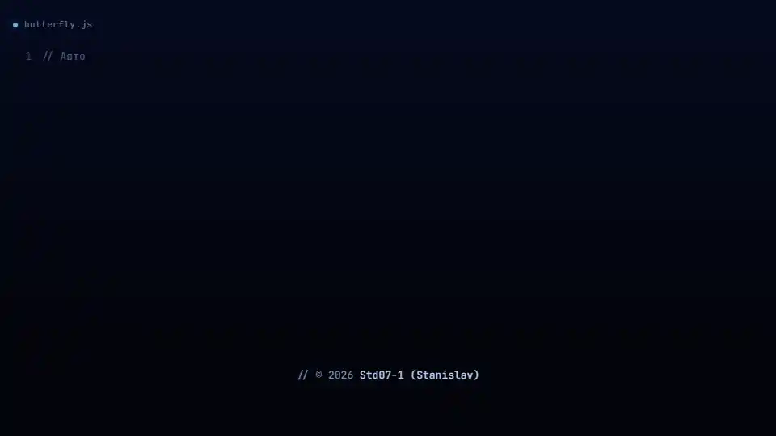
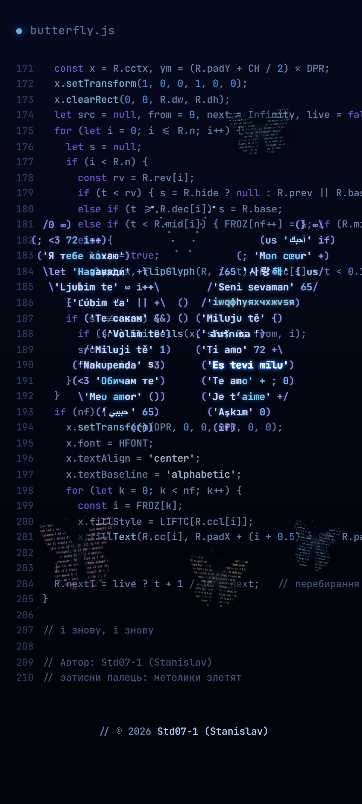
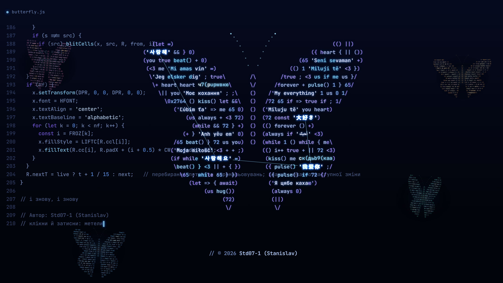

<h1 align="center">Мовою крил</h1>

<p align="center">
  Живі шпалери: код друкується сам, його літери злітають і складаються в метелика<br>
  з фраз «я тебе кохаю» <b>58 мовами</b>. Він оживає й відлітає, а код народжує нових.
</p>

<p align="center">
  <a href="https://std07-1.github.io/movoiu-kryl/live.html"><b>Дивитися наживо →</b></a>
  &nbsp;·&nbsp;
  <a href="#поставити-на-фон"><b>Поставити на фон</b></a>
  &nbsp;·&nbsp;
  <a href="#english">English</a>
</p>

<p align="center">
  
</p>

<p align="center">
  <sub>Народження метелика прискорено вдесятеро, далі сюжет утричі. Наживо перший метелик складається близько двох хвилин.</sub><br>
  Автор: <b>Std07-1 (Stanislav)</b>
</p>

## Дивитися

Відкрий [живу версію](https://std07-1.github.io/movoiu-kryl/live.html) на телефоні чи комп'ютері.

- Затисни палець або кнопку миші: метелики злетяться й кружлятимуть довкола.
- Торкнись поруч із метеликом: він сахнеться.

Сюжет живе сам. Перший метелик складається з коду, дихає крилами й злітає, код народжує нових, вони літають разом, а перший час від часу повертається близько й відпочиває.

Без інтернету: скачай [один HTML-файл](https://github.com/Std07-1/movoiu-kryl/releases/latest/download/movoiu-kryl.html) і відкрий його двічі клацнувши. Збірка й сервер не потрібні.

## Поставити на фон

Безкоштовно й без реєстрації. Посилання одразу скачують файл, усе разом є на [сторінці завантажень](https://std07-1.github.io/movoiu-kryl/) і в [Releases](https://github.com/Std07-1/movoiu-kryl/releases/latest).

| Пристрій | Що взяти | Як поставити |
|---|---|---|
| **Windows** | адреса живої версії або [HTML, 236 КБ](https://github.com/Std07-1/movoiu-kryl/releases/latest/download/movoiu-kryl.html) | [Lively Wallpaper](https://apps.microsoft.com/detail/9nkkggs3vx8g) (безкоштовний) → «+» → встав адресу `https://std07-1.github.io/movoiu-kryl/live.html`. Або перетягни скачаний файл у вікно Lively; тоді файл не переміщуй. |
| **macOS** | адреса живої версії або [PNG 2560×1440](https://github.com/Std07-1/movoiu-kryl/releases/latest/download/movoiu-kryl-2560x1440-5-rest.png) | [Plash](https://sindresorhus.com/plash) показує сторінку як шпалери: додай у ньому ту саму адресу. Для картинки: Системні параметри → Шпалери. |
| **Samsung** | [відео 15 с, 9,7 МБ](https://github.com/Std07-1/movoiu-kryl/releases/latest/download/movoiu-kryl-15s-1080x2400.mp4) | Галерея → відео → ⋮ → «Встановити як шпалери» → «Екран блокування». |
| **Інший Android** | [відео 60 с, 33,0 МБ](https://github.com/Std07-1/movoiu-kryl/releases/latest/download/movoiu-kryl-60s-1080x2400.mp4) або [PNG 1080×2400](https://github.com/Std07-1/movoiu-kryl/releases/latest/download/movoiu-kryl-1080x2400-5-rest.png) | Будь-який застосунок відеошпалер із Google Play або звичайні шпалери з картинки. |
| **iPhone** | [PNG 1179×2556](https://github.com/Std07-1/movoiu-kryl/releases/latest/download/movoiu-kryl-1179x2556-rest.png) | Скачане лежить у «Файлах»: відкрий картинку → Поширити → «Зберегти зображення». Далі Параметри → Шпалери → Додати нові → Фото. Відео й HTML iPhone шпалерами не ставить. |

<p align="center">
  
  &nbsp;
  
</p>

### Усі файли

| Файл | Що всередині | Для чого |
|---|---|---|
| [`movoiu-kryl-15s-1080x2400.mp4`](https://github.com/Std07-1/movoiu-kryl/releases/latest/download/movoiu-kryl-15s-1080x2400.mp4) | перший відпочиває, решта літають довкола | живі шпалери на телефон |
| [`movoiu-kryl-60s-1080x2400.mp4`](https://github.com/Std07-1/movoiu-kryl/releases/latest/download/movoiu-kryl-60s-1080x2400.mp4) | весь сюжет за хвилину | шпалери, презентація на телефоні |
| [`movoiu-kryl-15s-1920x1080.mp4`](https://github.com/Std07-1/movoiu-kryl/releases/latest/download/movoiu-kryl-15s-1920x1080.mp4) | те саме, що 15 с, у 16:9 | шпалери, слайд |
| [`movoiu-kryl-60s-1920x1080.mp4`](https://github.com/Std07-1/movoiu-kryl/releases/latest/download/movoiu-kryl-60s-1920x1080.mp4) | те саме, що 60 с, у 16:9 | презентація |

Усі відео крутяться по колу без стрибка, а починаються з чистого кадру, тож у презентації їх можна пускати з першої секунди. Кадри сюжету (складання, дихання, народження нового, політ разом, відпочинок) є для телефона й комп'ютера на [сторінці завантажень](https://std07-1.github.io/movoiu-kryl/).

## Приховане послання

У першому метелику час від часу складається тихий рядок:

> **це для тебе, Маша**

| Де | Як його побачити |
|---|---|
| Жива версія | Відкритим текстом: у крилі першого метелика, коли він уперше повертається відпочити, приблизно через 1 хв 15 с після того, як склався. Далі приблизно раз на хвилину-дві, теж під час відпочинку. З'являється на подиху, ім'я перебирає літери останнім, і за кілька секунд на цьому місці вже інша фраза. Ще є в самому коді, що друкується на екрані: числами під коментарем `// тсс`. |
| Відео 60 с | Відкритим текстом, один раз, у перші вісім секунд. |
| Відео 15 с | Немає: у петлі перший метелик лише відпочиває. |
| Картинки | Немає: це чисті кадри, у коді внизу рядок автора. |

У коді це масив кодів символів Unicode, рядки 229–234 у файлі HTML:

```js
// тсс
const SECRET = [
  1094, 1077, 32, 1076, 1083, 1103, 32, 1090, 1077,
  1073, 1077, 44, 32, 1052, 1072, 1096, 1072,
];
const MSG = String.fromCodePoint(...SECRET);
```

### Як написати своє

1. Відкрий консоль браузера (F12) і виконай із власними словами:

   ```js
   [...'твої слова'].map(c => c.codePointAt(0)).join(', ')
   ```

2. Встав отримані числа в `SECRET` у своїй копії [HTML-файла](https://github.com/Std07-1/movoiu-kryl/releases/latest/download/movoiu-kryl.html).

Послання має вміститися в один рядок крила. На телефоні вміщається до 19 символів, на екрані 1920×1080 до 43; довше воно просто не з'явиться. Відео й картинки лишаться такими, як є, бо це готові файли.

Зміна послання не змінює авторства: рядок `AUTHOR` у коді лишається як є. Умови в [LICENSE](LICENSE).

## Як це зроблено

- **Один HTML-файл** без збірки й зовнішніх бібліотек: canvas і JavaScript.
- **Код на екрані справжній:** скрипт читає власний текст і друкує уривки з нього, а метелик ловить літери саме з тих рядків, що пропливають під ним. З цих самих літер народжуються й нові метелики.
- **85 фраз 58 мовами** згруповані за мовними родинами. На кожен подих говорить одна родина.
- **Без мережі:** шрифт JetBrains Mono вбудований у файл, а Content-Security-Policy забороняє будь-які з'єднання, тому шпалери нічого нікуди не передають.
- **Бережно до пристрою:** 30 кадрів за секунду, роздільність знижується сама, якщо пристрій не встигає, і враховано системне налаштування «менше руху».
- **Відео й картинки** відрендерені цією самою сторінкою кадр за кадром у віртуальному часі. У 15-секундній петлі метелики летять замкненими кривими, тож на стику вони не роздвоюються.

Перша робота цієї серії: [Мовою серця](https://github.com/Std07-1/movoiu-sertsia).

## Права

© 2026 Std07-1 (Stanislav). Усі права застережено.

Можна дивитися код, ставити шпалери на свої пристрої, ділитися посиланням і писати своє послання для себе чи в особистий подарунок, якщо ім'я автора лишається в коді.

Не можна прибирати чи підміняти автора або видимий підпис, видавати роботу за свою, продавати її, поширювати інші змінені версії, а також копіювати код чи використовувати його, зокрема через інструменти штучного інтелекту, щоб створити чи згенерувати власну версію. Повні умови в [LICENSE](LICENSE).

Шрифт JetBrains Mono розповсюджується за [SIL Open Font License 1.1](docs/files/OFL.txt).

## English

**In the language of wings** is a live wallpaper for phone and desktop. The code types itself on screen, then its letters fly up and settle into a butterfly made of "I love you" in 58 languages. It comes alive and flies off, the code hatches more butterflies, and they fly together. It is one HTML file with no build step, no external libraries and no network access.

- **Watch:** open the [live version](https://std07-1.github.io/movoiu-kryl/live.html). The first butterfly takes about two minutes to form. Press and hold: the butterflies gather around your finger or cursor. Tap near one and it startles.
- **Use as wallpaper:** on Windows, add the live version's address to [Lively Wallpaper](https://apps.microsoft.com/detail/9nkkggs3vx8g); on macOS, add it to [Plash](https://sindresorhus.com/plash); on phones, use a video or an image from [Releases](https://github.com/Std07-1/movoiu-kryl/releases/latest). Samsung lock screens take the 15-second video; iPhones take images only.
- **Hidden message:** the first butterfly quietly spells out a line in Ukrainian. It is stored in the `SECRET` array as Unicode code points. You may change it in your own copy, for yourself or as a personal gift, as long as the author's name stays in the code.
- **Terms:** all rights reserved. You may not remove the author's name or the visible signature, present the work as your own, sell it, distribute other modified versions, or copy or use the code, including through AI tools, to create your own version. Full terms are in [LICENSE](LICENSE).
